  

  I design, build and host <b>business systems and websites</b> for companies, schools, NGOs and churches across Uganda —
  from enterprise HR and stock platforms to e-commerce and donation sites.

  
  
  
  
  
  
  
  
  
  
  
  
  
  
  
  
  

## 🚀 Featured systems

### 👥 HRMS — Human Resource Management System
     

An end-to-end HR platform for a telecom company in Uganda, covering the full employee lifecycle:
- 🧑‍💼 **People** — employee records, documents, contracts & renewals, transfers, promotions, awards, warnings, resignations and terminations
- ⏰ **Time & attendance** — shifts, attendance policies, time entries, regularisations, holidays, leave types, balances and applications
- 💰 **Payroll** — salary components, payroll runs and payslips with PDF export
- 🎯 **Recruitment & onboarding** — job requisitions and postings, candidates, interview rounds and feedback, offers and onboarding checklists
- 📈 **Performance** — KRA/KPI indicators, goals, review cycles and appraisals
- 🎓 **Training** — programmes, sessions, trainers, attendance and assessments
- 🧰 **Operations** — asset assignment, depreciation and maintenance, meetings with minutes and action items, trips and expenses, announcements, complaints
- 🔐 Role-based permissions, OTP login, email templates and webhooks

### 📦 Sales Stock Request & Distribution System
    

A role-based system that runs how sales stock moves from the warehouse to the field team:
- 📲 Stock for **SIM cards, MiFi routers, devices, airtime bundles and e-balance**
- 🔁 Full workflow: **request → verification → approval → allocation → issuance → pickup → returns**, including partial fulfilment
- 🧭 Dedicated dashboards for 15+ roles — requestors, field sales, regional managers, stock verifiers and controllers, store and supply-chain teams, finance, marketing, sales leadership, technical and customer-service teams
- 📊 Live stock monitoring, fulfilment tracking, returns analytics and accountability reports
- 🗺️ Retailer and promoter imports with zone and region mapping
- 📧 Email notifications, PDF request forms and scheduled cron jobs

### 🧪 Grace Laboratories — diagnostic lab platform
**🔗 [gracelaboratories.co.ug](https://gracelaboratories.co.ug)** &nbsp;    

A patient-facing platform for a diagnostic laboratory in Jinja with a full admin back office:
- 🧾 Test catalogue with categories and bundled test packages
- 🛒 Online booking, cart and orders with invoices and promo codes
- 👨‍👩‍👧 Patient accounts with family members, addresses and notifications
- 🩺 Phlebotomist assignment, branches, departments, doctors and referrals
- 📄 Result and report delivery to patients
- 🛠️ Filament admin panel with resources, pages and dashboard widgets

### 🏫 Asante International Christian School
**🔗 [asanteintchristian.ac.ug](https://asanteintchristian.ac.ug)** &nbsp;    

A hand-coded, mobile-first school website with full-site search, a self-updating events system, add-to-calendar, a swipeable reviews slider and a working contact form.

## 🗂️ Client websites

### 🎓 Schools & training
| Website | About | Built with |
|---|---|---|
| [greenvalleymsd.sc.ug](https://greenvalleymsd.sc.ug) | Green Valley Secondary School, Masindi | WordPress · Elementor Pro |
| [swifteaglespolytechnical.org](https://swifteaglespolytechnical.org) | Swift Eagles Polytechnical — online courses | WordPress · Tutor LMS · WooCommerce · Pesapal |

### 🤝 NGOs & foundations
| Website | About | Built with |
|---|---|---|
| [naabayafoundation.org](https://naabayafoundation.org) | Naabaya Foundation — online donations & student sponsorship | WordPress · Elementor · GiveWP |
| [agribuddyug.org](https://agribuddyug.org) | Agri Buddy Uganda — farmer livelihoods | WordPress · Elementor |
| [cevicug.org](https://cevicug.org) | CEVIC Uganda — support for visually impaired children | HTML · CSS · JavaScript |
| [rtcuganda.org](https://rtcuganda.org) | Research Triangle Consortium — health research | WordPress · Elementor |
| [sabinytransformationinitiative.org](https://sabinytransformationinitiative.org) | Sabiny Transformation Initiative | WordPress · Elementor |
| [trgduganda.org](https://trgduganda.org) | Tropical Resource Governance for Development | WordPress · Elementor |
| [ugirlchildinitiative.org](https://ugirlchildinitiative.org) | Girl Child Initiative Uganda | WordPress · Elementor · WooCommerce |
| [womensocialcomposite.org](https://womensocialcomposite.org) | Women Social Composite Foundation | WordPress · Elementor |

### ⛪ Churches & ministries
| Website | About | Built with |
|---|---|---|
| [spiritfilledinternational.org](https://spiritfilledinternational.org) | Spirit Filled International — events & services | WordPress · Elementor · The Events Calendar |
| [voiceofthelad.org](https://voiceofthelad.org) | Voice of the Lad Ministry | WordPress · Elementor · Events Calendar · WooCommerce |
| [gracengloryministries.org](https://gracengloryministries.org) | Grace and Glory Ministries | WordPress · Elementor |

### 🏔️ Tourism
| Website | About | Built with |
|---|---|---|
| [rwenzoritrekking.com](https://rwenzoritrekking.com) | Rwenzori Trekking Services | WordPress · Elementor Pro |
| [elgontrekking.com](https://elgontrekking.com) | Mount Elgon Trekking Uganda | WordPress · Elementor Pro |

### 🏢 Business & e-commerce
| Website | About | Built with |
|---|---|---|
| [karibucoffeeug.com](https://karibucoffeeug.com) | Karibu Coffee — online coffee shop | WordPress · Elementor Pro · WooCommerce |
| [melroyinternational.com](https://melroyinternational.com) | Melroy International Limited | WordPress · Elementor · WooCommerce |
| [extrakil.com](https://extrakil.com) | Extrakil Pest Control | WordPress · Elementor · Forminator |
| [goldenvaultugandalimited.com](https://goldenvaultugandalimited.com) | Golden Vault — swimming pool construction | WordPress · Elementor |
| [tikvahservicesltd.com](https://tikvahservicesltd.com) | Tikvah Services — engineering contractors | WordPress · Elementor |
| [vidamcl.com](https://vidamcl.com) | Vida Management Consulting | WordPress · Elementor |
| [one-ksolutions.com](https://one-ksolutions.com) | One-K Solutions International — general supply | WordPress · Elementor |
| [spectrumcolourhub.com](https://spectrumcolourhub.com) | Spectrum Colour Hub | WordPress · Elementor Pro |

## 🛠️ Infrastructure I run

| | |
|---|---|
| 🖥️ **Server** | Linux VPS · OpenLiteSpeed · CyberPanel · MariaDB · PHP 8.x |
| 🛡️ **Edge & security** | Cloudflare DNS and proxy on every site · Origin certificates with Full (Strict) SSL · TLS 1.2+ |
| ✉️ **Email** | Postfix + Dovecot mail server with webmail for every client domain |

## 📫 Get in touch

  
  
  

